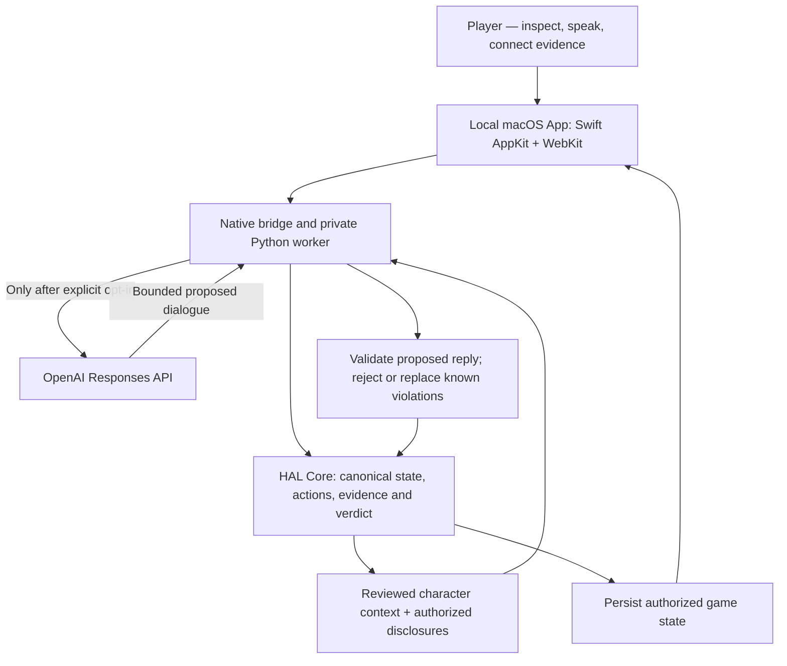

# Witness Loop · 雨夜回环

<p align="center">
  <strong>Meet Lin Wu — the AI witness who remembers, conceals, and responds.</strong><br/>
  <em>A cinematic detective RPG built on a deterministic Harness Activation Layer (HAL).</em>
</p>

<p align="center">
  
</p>

<p align="center">
  <a href="#play-the-prototype">Play the prototype</a> ·
  <a href="#how-it-works">How it works</a> ·
  <a href="#engineering-evidence">Engineering evidence</a> ·
  <a href="#status--roadmap">Release roadmap</a>
</p>

> **Current status — Public experimental macOS Beta.** [Download v0.3.0-beta.1-unsigned](https://github.com/Chikanofaka/HAL-P2D-001/releases/tag/v0.3.0-beta.1-unsigned) for **Apple Silicon (arm64)**. This is an **unsigned, unnotarized GitHub Prerelease**: Gatekeeper may block opening it, and a clean second-Mac compatibility test has not been completed. Offline dialogue is simulated; live OpenAI mode has a mock-tested native adapter but has not passed paid-model UAT. Not an Apple-certified or App Store release.

## Step into the mystery

At the rain-soaked Yunjiang station, Zhou Xu has gone missing. A stopped clock reads **00:17**. A red garment hangs near the lockers; an unused-looking ticket lies on a bench; the final train disappears into the rain. A nervous station dispatcher ends a mysterious phone call as you arrive.

You are the detective. First **observe**, then **question Lin Wu**, connect what you can substantiate, and decide what the evidence supports. Her dialogue can be expressive and evasive, but the model does **not** control the canonical case facts or verdict.

<p align="center">
  
  <br/>
  <sub>Bundled scene artwork (not a screenshot of an externally distributed release). The native UI adds clickable evidence hotspots, character layering and captions.</sub>
</p>

### What makes this different

| Player experience | Under the hood |
|---|---|
| A distinct NPC with a history, emotional tension, and natural conversation | Reviewed character context compiled from `identity.md`, `memory.md`, `user.md` and narrative source material |
| Ask questions freely in English or Mandarin | Optional LLM-powered responses, plus an offline simulated mode |
| Inspect the station clock, red fabric, Zhou Xu's ticket, and departing train | Evidence states distinguish **visible → inspected → authenticated / interpreted → linked** |
| Build trust, challenge testimony, and keep a case notebook | Attributed session memory, explicit action confirmations and bounded disclosure rules |
| Reach truth, partial resolution, or false accusation | **HAL**, not the model, authoritatively commits actions, evidence and outcomes |

> **Design principle:** Probabilistic character performance; deterministic game authority. Lin Wu can withhold her brother's involvement, but the system must not let a model rewrite the fact that her brother exists. Guardrails detect specified contradictions; they do **not** guarantee perfect semantic consistency.

## Play the prototype

**Download:** [Witness Loop v0.3.0-beta.1-unsigned (Apple Silicon ZIP)](https://github.com/Chikanofaka/HAL-P2D-001/releases/download/v0.3.0-beta.1-unsigned/WitnessLoop-v0.3.0-beta.1-unsigned-macOS-arm64.zip). Extract and move `Witness Loop.app` to Applications; due to missing Developer ID signature and Apple notarization, you may need to review the launch block in **System Settings → Privacy & Security → Open Anyway**. Only proceed if you trust the publisher. **Do not disable Gatekeeper globally.**

**Build from source:** Requires a Mac with a Swift compiler / compatible macOS SDK and the system Python used by the developer build. The script targets macOS 12+; broader compatibility has not been verified.

```bash
git clone https://github.com/Chikanofaka/HAL-P2D-001.git
cd HAL-P2D-001

# Offline Core regression checks + rebuild + native mocked-provider tests:
bash scripts/verify_witness_local.sh

# Launch the locally built, unsigned development app:
open "integrations/witness_loop/dist/Witness Loop.app"
```

To exercise the actual native UI/bridge with **synthetic** saves and **no** provider calls:

```bash
"integrations/witness_loop/dist/Witness Loop.app/Contents/MacOS/WitnessLoop" --ui-self-test
```

See the [step-by-step game guide](integrations/witness_loop/README.md) and [reproducible UAT walkthrough](engineering/WTL03_UAT.md).

**Do not publish the generated `.app` as a universal installer yet.** The current build is unsigned, not notarized, and its save configuration is tied to the source checkout's absolute path. Rebuilding locally is required after moving the checkout. This is an engineering preview, **not** a portable app bundle.

### Playing the case

1. Read the case brief and opening narration; the interrupted arrival-time call is **not** the earlier incoming 00:17 call.
2. Explore the **empty platform**. Seeing an object does not automatically collect it: click the four evidence hotspots to inspect them.
3. Approach Lin Wu. Advance her subtitle, then question her through sequential player/NPC turns. Review previous dialogue and evidence in the drawers.
4. Confirm case-related questions before spending one of the **six case actions**. Free conversation and environmental inspection do not spend case actions.
5. Link supported evidence, advance the three-act investigation and submit a verdict. Different evidentiary choices can reach three bounded outcomes.

## Two dialogue modes

| Mode | Behavior | Costs and credentials |
|---|---|---|
| **Offline / simulated** | Local scripted dialogue with real deterministic game state, memory, evidence and verdict rules | No API key; no model calls |
| **OpenAI-enhanced (opt-in)** | The native host can request bounded topic classification and character dialogue from the OpenAI Responses API | Requires a separately billed OpenAI Platform API key entered **only** in the native secure sheet |

The native host keeps the key in process memory until Disconnect or Quit; it is not intentionally sent to the webpage, Python Core, or saved files. This is not a claim of a perfect security boundary. The app uses a fixed API endpoint, explicit consent, request limits, and `store:false` requests. **Up to two model requests per dialogue turn; at most 20 requests per activation**. The count is **not** a dollar spending cap. An API request may already be used to classify a case question before its action is confirmed. Fees, provider handling and eligibility depend on the user's OpenAI Platform account.

**Do not paste credentials into a GitHub issue, README, terminal command or screenshot.** The v0.3 release still needs a real-provider human acceptance pass; offline/mock checks must not be interpreted as proof of live conversational quality.

## How it works



**Authority split:** The language model proposes conversation and intent. The trusted HAL domain validates and commits state. It does not let a model invent collected objects, rewrite family identity, create a verdict, or execute arbitrary skill-package code.

The authoring chain is:

`integrations/witness_loop/source/*.md` → reviewed compiler → `runtime/trusted_adapters/witness_character.json` → bounded model context and provenance digests.

Full director-only story material is excluded from the player-facing model projection and packaged app resources. Because the **source repository is public**, source files can still reveal spoilers to people browsing the code.

## Engineering evidence

The v0.3 engineering record reports **287 Python regression tests** and **52 native mocked-provider self-tests**. A subsequent local native UI run reported **21 / 21 PASS**, including scene introduction, all four hotspot inspections, English simulated dialogue, history/notebook, compact layout and all three verdicts. These tests used synthetic saves, not a billable live API request.

- [Engineering implementation receipt](engineering/WTL03_RECEIPT.md) — files changed, Core invariants and limitations; its earlier `PENDING_FINAL_GUI` entry predates the subsequently observed 21/21 UI run.
- [Native GUI acceptance guide](engineering/WTL03_UAT.md) — exact test commands and case walkthroughs. Some listed final screenshots are written to local ignored `.build-cache/` paths and are **not all published in this repository**.
- [Artwork provenance](integrations/witness_loop/ASSET_PROVENANCE.md) — original generated/illustrated assets vs. supplied references.
- [Source provenance](integrations/witness_loop/SOURCE_PROVENANCE.md) — canonical character files vs. historical snapshots.
- [Native security boundaries](integrations/witness_loop/native/README.md) — credential transport, strict parsing, consent, budgets and limits.

Tests and fixed-pattern reply checks are **not** a substitute for real-player UAT, third-party security review or App Store certification.

## Repository guide

| Location | What's inside |
|---|---|
| `integrations/witness_loop/ui/` | Cinematic scene, evidence hotspots, sequential conversation interface and local artwork |
| `integrations/witness_loop/native/` | Swift AppKit host, secure credential entry, WebKit bridge and native tests |
| `integrations/witness_loop/source/` | Canonical Lin Wu character and narrative authoring files |
| `runtime/trusted_adapters/` | Witness domain, character compiler/projection and trusted adapters |
| `runtime/hal_core/` | Common deterministic execution contract and transactional runtime |
| `runtime/fixtures/` | Witness plus Research/Returns demonstration domains |
| `branding/WitnessLoop.icns` | Lin Wu character-IP macOS application icon |
| `scripts/` | Build, verification, source packaging and character compilation |
| `engineering/` | Architecture decisions, tests, handoff and UAT records |
| `baseline/` | Original HAL PRD/MVM and earlier engineering references |

The broader **HAL-P2D-001** repo contains the general Harness Activation Layer research and contract work, with Witness Loop as its featured interactive application. Research Diagnostics and Returns Operations remain separate fixtures.

## Status & roadmap

| Stage | Status |
|---|---|
| Character-IP branding and bundled native app icon | Implemented |
| Cinematic rainy platform, inspection and sequential UI | Implemented in local v0.3 |
| Deterministic three-outcome case and v1 save migration | Implemented and regression-tested |
| Live OpenAI v0.3 personality, memory and bilingual human UAT | **Pending** |
| Experimental unsigned Apple Silicon GitHub ZIP prerelease | **Published** ([download](https://github.com/Chikanofaka/HAL-P2D-001/releases/tag/v0.3.0-beta.1-unsigned)); external Mac validation pending |
| Developer ID signing, notarization and wider cross-Mac compatibility | **Not yet available** |
| Mac App Store sandbox, privacy/compliance, TestFlight and review | **Planned** |

**Human Gate: DOING / awaiting acceptance.** No App Store or portable binary release is implied by this public source showcase. Distribution and reuse terms for code, generated artwork and supplied references require explicit rights review; there is no license grant merely because the repository is public.

---

**Witness Loop is both a small playable mystery and an engineering exploration:** how do you give a character conversational latitude without giving a probabilistic model authority over game truth?

*Built with Swift, Python, WebKit, HAL and an optional OpenAI Responses API connection.*
