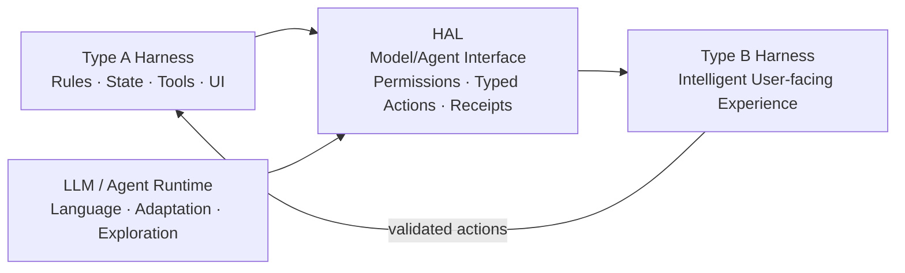
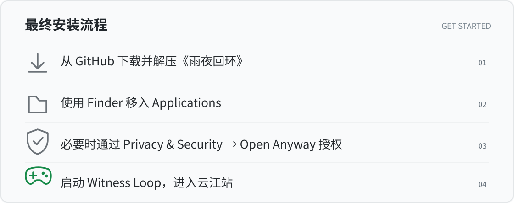

# Harness Activation Layer (HAL)

### From deterministic harnesses to intelligent, agentic applications

**What if an existing application could gain intelligence without surrendering its underlying logic?**

A traditional **Type A harness** follows programmed rules, fixed workflows and deterministic state transitions. It can be reliable and complete within its domain, but its behavior is constrained by what engineers explicitly authored.

**Harness Activation Layer (HAL)** explores a deliberately controlled insertion point between that deterministic system and an LLM or agent runtime. Rather than rebuilding the application around a chatbot, HAL seeks to connect a model to the **existing domain's tools, permissions, state and interface**—so it can propose flexible dialogue, interpretations, personalized interactions or agentic actions while the harness retains authority over what actually happens.

This research direction calls the resulting architecture a **Type B harness**: a user-facing application in which probabilistic intelligence extends deterministic capabilities without being allowed to overwrite the rules of the world.

> **Research thesis, not a claim of universal plug-and-play.** The model connection, permission contracts, validation and execution remain domain-specific today. The general, reusable transformation has not yet been proved across independent real-world applications.

## The architectural proposition

**The 'hole' is an interface, not an uncontrolled breach.** HAL introduces a reviewable extension point: model output is treated as a proposal, and trusted application logic decides whether it is valid, authorized and able to change state.

The ambition is not simply to attach a text box to software. It is to investigate how **new kinds of products and experiences** might emerge when fixed systems gain bounded intelligence, individuality and agency.

### Where it could lead

| Existing deterministic application | Possible intelligence-enabled experience | Status |
|---|---|---|
| Website or customer interface | Contextual conversation and adaptive assistance | Conceptual application class; not demonstrated here |
| Game engine and authored story | Intelligent NPCs, responsive narrative and eventually agent-populated social worlds | **Witness Loop** is an early offline-playable proof of concept; autonomous multi-agent social worlds remain speculative |
| Productivity or enterprise software | Natural-language orchestration and governed agent actions | Research direction; not proven as a universal SuperApp |
| Specialist research/operations harness | LLM-guided analysis anchored in typed tools and auditable outcomes | HAL's deterministic Research/Returns fixtures demonstrate reusable contracts, not production autonomous inference |

The long-term hypothesis: future applications will increasingly be built around **human-facing experiences shared with model-driven agents**. HAL-like connectors may become a useful architectural pattern for that transition. This is a hypothesis to test, not a declaration that every harness will adopt it or that the genre has no prior art.

## First Type B experiment: 雨夜回环 · Witness Loop

  

**Witness Loop — After the Last Train** is an experimental detective-story game inspired by galgame/visual-novel and *honkaku* mystery conventions. A missing passenger, a clock stopped at **00:17**, four observable clues and a dispatcher with secrets provide a bounded world in which to explore how intelligence and agency might interact with authored game truth.

- **Deterministic foundation:** Case facts, evidence, action permissions, persistent state and three bounded endings remain under trusted game logic.
- **Intelligence boundary:** An optional native OpenAI adapter can propose dialogue; its interface and safeguards are implemented and mock-tested, but real-model personality UAT has **not** been completed.
- **Actual public MVP:** A downloadable offline Mac preview with a working native UI. The local release candidate and ZIP-extracted application passed **21/21 native UI checks**; one Chrome-downloaded installation launched correctly after moving the app to Applications and approving it through macOS security settings.
- **Not yet implemented:** A fully self-driving NPC society, autonomous multiplayer game, open-ended agent-generated narrative, or a generalized Type B conversion of arbitrary games.

### Play the experiment

**[Download Witness Loop for Apple Silicon Mac →](https://github.com/Chikanofaka/HAL-P2D-001/releases/download/v0.3.0-beta.3-adhoc/WitnessLoop-v0.3.0-beta.3-adhoc-macOS-arm64.zip)**

1. Download and unzip the game.
2. **Use Finder to move `Witness Loop.app` into Applications before launching.**
3. If macOS blocks the unsigned-by-Developer-ID / unnotarized preview, approve via **System Settings → Privacy & Security → Open Anyway** *only if you trust the release*.
4. Open the game and enter Yunjiang station.

**Safety / compatibility:** This is an experimental Apple Silicon preview, ad-hoc signed but **not Developer ID signed or notarized**. Never disable Gatekeeper globally or blindly strip quarantine metadata. Full downloaded-app game completion, broad Mac compatibility and production live-model behavior remain unverified.

**[Witness Loop story, gameplay and onboarding showcase →](showcases/WITNESS_LOOP.md)**

## Research program and evidence

This repository contains three interconnected levels of work:

1. **HAL architecture and original PRD/MVM.** A shared local-first shell, curated domain harness package contracts, capability preflight and distinct user entry routes. See [HAL PRD](baseline/prd/HAL_PRD_v2_0.md) and [architecture options](baseline/prd/ARCHITECTURE_OPTIONS.md).
2. **Type A deterministic platform and fixtures.** Versioned, validated specialist domain actions and a trusted Python core, with synthetic Research and Returns examples. See [runtime](runtime/README.md) and [architecture baseline audit](engineering/BASELINE_AUDIT.md).
3. **Type B application exploration.** The Witness Loop native experience, persistent case state, bounded model interface, actual UI integration checks and documented release journey. See [Type B implementation PRD](engineering/HAL_WITNESS_TYPE_B_PRD.md), [implementation receipt](engineering/WITNESS_INTEGRATION_RECEIPT.md) and [full engineering showcase](engineering/WITNESS_TECHNICAL_SHOWCASE.md).

### Terminology: Type A / Type B vs Path A / Path B

- **Type A / Type B** describes the proposed **nature of the harness**: deterministic by default versus model/agent-extended.
- **Path A / Path B** in the earlier HAL PRD describes **two user onboarding routes**: developer source/IDE access versus consumer product activation. The paths are not the architecture types and should not be conflated.

## Engineering truth and open questions

**Demonstrated:** HAL's typed/domain-controlled deterministic workflows, executable Research/Returns fixtures, a domain-specific Witness application, offline simulated NPC interaction, local persistence and the tested Mac UI flows.

**Not established:** A generic adapter that can safely 'activate' any GitHub harness, portability to arbitrary domains without substantial adapters, real autonomous agent agency in social worlds, consistent LLM-based NPC intelligence at production quality, measured commercialization demand, or claims of an unprecedented first-ever game genre.

**Next research gates:** Validate live-model NPC behavior against authored constraints; demonstrate a second independent real-world Type B application without rewriting the HAL core; measure the adapter work and safety limitations; then investigate autonomy, multi-agent dynamics and human-agent co-presence.

---

*HAL is the research project. Witness Loop is its first public application experiment. The repository's technical identifier is historical; the aim is to explore a broader class of intelligent applications.*
