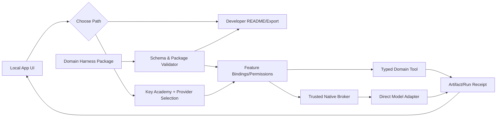

# HAL v2 — Architecture Options and Decision Record

**Working hypothesis:** local-first application with embedded web UI and native execution broker, not a hosted cloud app and not a static HTML that receives production keys.

| Candidate | Benefits | Costs/failures | Current disposition |
|---|---|---|---|
| P0 GitHub ZIP + README | trivial distribution, IDE owners already know workflow | excludes ordinary consumers, common UX remains manual | comparison baseline |
| P1 Per-domain Tauri native apps | predictable vertical fidelity, packaged runtime | duplicated onboarding/version drift, hard 2nd domain maintenance | feasible alternative |
| P2 Shared HAL Shell + signed/curated domain packages | reusable A/B education, capability contracts and trust controls | requires explicit adapters, schema governance, potential over-abstraction | **MVM hypothesis** |
| P3 Hosted web runtime | cross-device convenience and background jobs | credential custody, cloud data/ops costs, contradicts local-first promise | later conditional option |

## Logical decomposition (implementations not prescribed)

## Concrete API contracts / proposed schema
- `inspect_package(bytes) -> {digest,manifest,parse_errors,required_files,licenses}`
- `list_domains() -> [{id,version,description,features,permissions}]`
- `resolve_feature(feature,provider,grants) -> {ready,missing_ports,blocked_reason}`
- `native_credentials.store(provider,secret) -> opaque_reference` (never return raw secret to browser)
- `run_task(domain,feature,input,grants,budget) -> stream<RunEvent>` (bounded, cancelable)
- `export_artifact(run_id,format) -> safe file / user-selected path`
- `human_gate.submit(decision,feedback) -> user-visible receipt; publication remains separately gated`

## Selected implementation principles
1. Keep domain logic as skills and typed tools, not copied into HAL core.
2. Allow only curated manifests in v0; arbitrary code must be quarantined and inspected.
3. Enforce prompt/data/action separation and deny external writes by default.
4. Make errors explicit, retain partial approved artifacts and do not invent live LLM results.
5. For Ready, provide a zero-server static MVM with actual deterministic domain tools. For Doing, add signed native runtime and actual LLM integrations.

**Decision state:** recommended for MVM; no approved production stack, no security certification.
