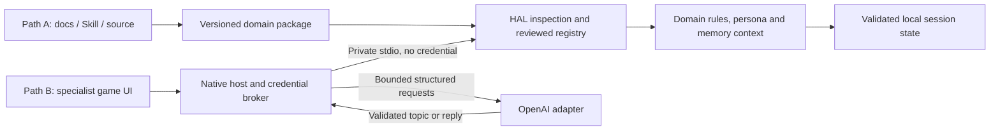

# HAL × Witness Loop: Type B implementation addendum

Date: 2026-10-16. Stage: DOING. This adds the user's clarified intelligent-harness vision to the approved [HAL v2 PRD](../baseline/prd/HAL_PRD_v2_0.md); it does not replace that baseline or approve production release.

## Product outcome

HAL should let a purpose-built application use a supported language model while retaining its own identity, expertise, rules, tools, memory and user interface. A credential authorizes model access. HAL supplies the domain context and controls how model output becomes an application action. It cannot infer the complete domain or safely execute arbitrary repositories merely because a key has been supplied.

Path A is the developer route: README, Skills, versioned contract, source package and IDE onboarding, with no credential supplied to HAL. Path B is the consumer route: product onboarding, provider education, native activation, and a specialist interactive experience. They are routes into the same architecture, not quality tiers. “Type B intelligent harness” describes the requested consumer experience; “administrative harness” is not a new HAL contract type.

The first application is Witness Loop, not a general assistant. Lin Wu remains a night dispatcher protecting her brother in one missing-person case. The player can pursue evidence or explore her personality. Meaningful choices affect durable relationships, clues and endings. Intelligence adds flexible language and interpretation; authoritative case state remains inspectable.

## Grounding and approved changes

Sources: the user's detailed request and Mac/OpenAI selections; the approved HAL baseline; the supplied [Witness PRD](https://drive.google.com/file/d/1v4yj1ZKqCv0noqgQj7s7TAhRxDgzXOIj/view); and the preserved [Witness source](../integrations/witness_loop/source/experience-prd.md). [Source provenance](../integrations/witness_loop/SOURCE_PROVENANCE.md) records hashes and review findings.

Keep the original wedge: one witness, three scenes, four clues, three endings. Change six total conversations to **six plot actions**, with casual dialogue outside that counter. Casual conversation is still bounded by storage, context and provider budgets; it is not unlimited compute or perfect memory. Art, voice, multiplayer, world generation and plot expansion are later work. The prototype prioritizes the three requested behaviors:

1. **Hard plot reactions.** Domain keywords override model topic proposals. Explicit commitments, prior questions, available evidence and scene constraints determine permitted consequences. A model cannot create arbitrary evidence or choose the ending.
2. **Persona conversation.** A model receives role, values, authorized facts, scene, selected memories and conversation context. It may answer freely in character and naturally nudge toward available clues. In offline mode these responses are explicitly simulated. Persona quality and non-disclosure in prose remain live evaluation requirements, not guarantees supplied by a prompt.
3. **Remembered relationship.** Store player statements, explicit commitments and actual domain admissions with distinct provenance. Restore them across launches. Recall selected relevant history across scenes; expose readable memory, export and deletion. Model prose never becomes authoritative evidence merely by saying something happened.

## Consumer journey and acceptance

| Step | Required behavior | Implemented acceptance evidence |
|---|---|---|
| Enter | Choose developer assets or the playable game | Native UI has both routes; same inspected Witness package and reviewed adapter |
| Understand | Explain identity, memory, provider access, request costs and simulated/live distinction | Four-step Chinese onboarding; visible mode and request counter |
| Activate | Native credential entry; selected provider/model; explicit bounded-session consent | AppKit secure field; no credential field in web UI; activation itself makes no request |
| Verify | Do not infer working credentials from formatting or package metadata | ACTIVATED_UNVERIFIED becomes LIVE_VERIFIED only after a valid provider response; not live-tested during engineering |
| Play | Free text, relationship HUD, unlocked evidence, contradiction board and verdict | Real state transitions in the Core; specialized UI; three tested endings |
| Remember | Same session survives restart; player speech is not a canonical case fact | Atomic saved state, validated restore, provenance labels, bounded retrieval |
| Recover | Failed/invalid output does not partially advance a turn | Prepare/commit/cancel transaction; failure clears the draft; no silent live-to-simulated fallback |
| Leave | Disconnect clears the credential; export and forget have visible controls | Session-only native key; native export panel; native delete confirmation; deletion does not erase prior exports |

## Shared architecture and extension contract

The existing `hal-domain/v1` contract, safe root/GitHub-wrapper ZIP inspection, curated tool bindings and typed value schemas remain in force. Witness adds `narrative_state` and `witness-turn-input/v1` / `witness-turn-output/v1`; Research and Returns continue through the same engine.

The interactive host registers a reviewed domain lifecycle: start, validate state, classify context, prepare turn, finalize turn, action and memory projection. It owns revision checks, transaction IDs, persistence, receipt and private stdio framing. The domain owns topic schema, identity, plot, facts and consequences. Native code owns credentials, provider requests and the provenance flag. The renderer receives state and activation status, never the credential or authority to submit a model result.

The current host/UI binding is installed for Witness only. Action names/profile fields in this pilot still reflect the game; arbitrary package-driven consumer UI, a general multi-domain app selector and universal embedding SDK are **not complete**. The native model loop uses the same inspected installed domain, but its session activation evidence is not yet a general capability grant consumed by the offline CLI. CLI model preflight deliberately remains blocked. Adding another real interactive domain is the next test of reuse, not a capability claimed from three fixtures alone.

Domain source import remains data-only. A new game or specialist app must provide its contract, approved assets, state schema, tested rules/tools, context builder and UI integration. A reviewed host binding must be installed. A package's own README or Skill cannot grant code execution, network access, credentials or external writes.

## Model contract and budgets

First delivery: local macOS app, OpenAI direct API, configurable model with default `gpt-4.1-mini`. The adapter uses Responses structured outputs, not a conversational web subscription. Official references: [Structured Outputs](https://developers.openai.com/api/docs/guides/structured-outputs?api-mode=responses) and [model capabilities](https://developers.openai.com/api/docs/models/gpt-4.1-mini). Account/model entitlement and actual responses remain unverified locally.

A live turn has two bounded requests: classify a domain topic, adjudicate and stage local changes, then generate a reply using only the allowed context. Commit after the reply passes validation. Model-proposed topics can influence rule routing; local hard triggers and guards decide permissible changes. This is a bounded two-stage loop, not an autonomous general-purpose tool agent.

- Fixed `https://api.openai.com/v1/responses`; no endpoint supplied by a package or web UI.
- Native in-memory credential only, removed on disconnect/quit; no Keychain persistence yet.
- Explicit 20-request budget per activation; up to two requests per submitted message. Re-activation requires native consent again. This is not a dollar-denominated ceiling.
- 200 classifier / 600 reply output tokens, 30-second request timeouts, no application retries, no redirects, `store:false`, ephemeral URLSession.
- Bounded input context 16,000 UTF-8 bytes; provider response at most 256 KiB; strict JSON fields, duplicate-key/nonfinite/refusal/incomplete/error rejection.
- Player text at most 1,000 characters; reply at most 4,000; transcript retains 120 entries; memory retains 256 records with protected commitments/admissions, and selected excerpts enter model context. Save cap 2,000,000 bytes.

These controls limit effects and resources. They do not guarantee zero hallucinations, perfect recall, monetary accuracy, provider zero retention or immunity to misleading dialogue. Credentials are ordinary native process memory, not guaranteed zeroizable memory. The local trusted process is not an OS security sandbox.

## Requirement trace and remaining gates

| HAL baseline | Witness increment | Remaining acceptance |
|---|---|---|
| F01, F03–F05 | Dual entry, developer assets/source, onboarding/provider education | Human usability validation |
| F02, F07–F08 | Inspected v1 package; third specialist adapter; deterministic narrative/evidence outcomes | Another real interactive domain without rewriting the shared host |
| F06, F09–F10 | Native structured model adapter, truthful activation states, same domain context | Authorized real request, entitlement/error tests, generalized capability grants |
| F11, F13 | Atomic restore, readable memory export, failed-turn rollback, cancellation | Human native panel UAT and longer live sessions |
| F12 | DOING retained; no publication, deployment or billable engineering test | Separate release decision |
| F14 | Native credential boundary implemented and mock-tested | Keychain option, distribution hardening, live credential UAT |
| F15 | Bounded topic/reply loop with adjudicated changes | Live persona/semantic-trigger quality and adversarial prompts |
| F16 | First user-supplied domain applied | Second independent real integration, license/reuse review and measured effort |

Before calling this an effective general meta-harness: validate another specialist domain; generalize lifecycle/actions/UI registration; establish signed package/publisher trust and license handling; test supported OS/interpreter combinations; package the Python runtime or remove that prerequisite; sign/notarize distribution; add provider adapters with explicit capability probes; and evaluate long-session memory and model behavior.

Before calling this game's AI experience validated: a human enters an authorized OpenAI key **inside the native app**, accepts a bounded live session, then checks paraphrased triggers, negated promises, casual personality, natural nudges, cross-scene recall, failure/cancel behavior and all endings. Never paste the credential into chat. The original user test remains useful: at least 3 of 5 players notice cross-scene memory, want to keep questioning and distinguish real state from simulated language. No such user study is claimed.

Local engineering can proceed without those live inputs. The delivered offline implementation and mock adapter tests establish mechanics and boundaries; they do not establish the intended personalized intelligence or universal compatibility.
